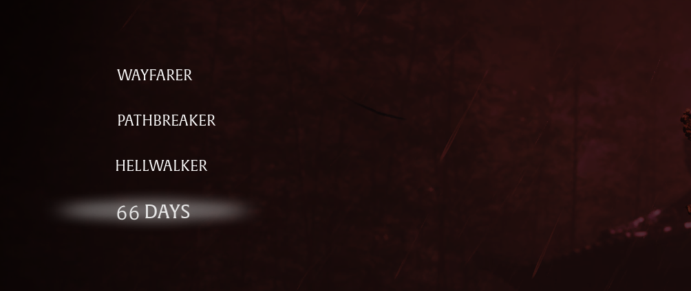

# 66 Days Unlocked

Unlocks the 66 Days difficulty from the start: begin a new game in it without beating the game once.

## What it does

- The 66 Days difficulty is open in the difficulty menu of a new game, also when you have not finished the game
  yet.
- 66 Days itself stays as the game makes it: the Hellwalker rules and 66 deaths. At 0, the game deletes the save.
- Nothing else changes: the other difficulties and New Game Plus stay as they are.
- The mod writes nothing into your save. Without the mod, 66 Days is locked again until you finish the game.

## Screenshots

## How to install

1. Download the zip of the latest release on GitHub (`phantombladezero_66daysunlocked_<version>.zip`).
2. Open the game folder `ProjectPBZ\Content\Paks\`. If it has no folder `~mods`, create it.
3. Unpack the three files of the zip (`phantombladezero_66daysunlocked_P.pak`, `.utoc` and `.ucas`) into `ProjectPBZ\Content\Paks\~mods\`.
4. Start the game.

To update the mod, replace the three files with the ones of the new release. To remove it, delete the three files.

## How to use

Start a new game and choose 66 Days in the difficulty menu.

## Compatibility

- Game version: Release (Steam build 26266538) (`CL-301524_JKS-17219`).
- No UE4SS needed.
- The mod replaces the game's script for the difficulty menu, `ProjectPBZ/Content/JavaScript/UI/Widget/DifficultySelect_V2.js`.
  A mod that replaces the same file conflicts with this one; only one of them works.
- A game update that changes this script needs a new version of the mod.

## Known issues

None yet.

## How to build

Anyone can build this mod from its source code and check that the download matches it.

1. Install the tools: Windows PowerShell 5.1 (part of Windows), [repak](https://github.com/trumank/repak/releases)
   v0.2.3 and [retoc](https://github.com/trumank/retoc/releases) v0.1.5 in a folder `_tools\repak\` and `_tools\retoc\`
   above the repository (or set `UE5_TOOLS`); optional: [Node.js](https://nodejs.org/) for the check of the script.
   `README.md` has the details.
2. Build it: `powershell -ExecutionPolicy Bypass -File .\build.ps1`
3. Find the files: `dist\phantombladezero_66daysunlocked_P.pak`, `.utoc` and `.ucas`.

## Credits

Made by Kintaro. MIT license: you may use, change and share this mod. Phantom Blade Zero and its files belong to
their makers; the mod changes only what is listed above.
