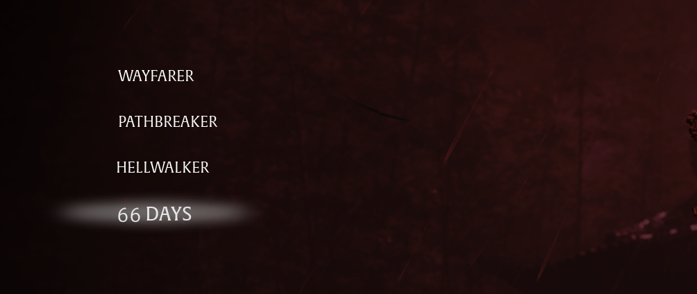

# 66 Days Unlocked

Unlocks the 66 Days difficulty from the start: begin a new game in it without beating the game once. A PBZModLoader mod.

## What it does

- The 66 Days difficulty is open in the difficulty menu of a new game, also when you have not finished the game
  yet.
- 66 Days itself stays as the game makes it: the Hellwalker rules and 66 deaths. At 0, the game deletes the save.
- Nothing else changes: the other difficulties and New Game Plus stay as they are.

It is a PBZModLoader mod: a script in the game's own script engine. It replaces no game file and writes nothing into
the save: without the mod, 66 Days is locked again until you finish the game.

## Screenshots

## How to install

1. Install [PBZModLoader](https://github.com/KintaroModding/phantombladezero_pbzmodloader) 2.1.0 or later.
2. Download the zip of the latest release on GitHub (`phantombladezero_66daysunlocked_<version>.zip`).
3. Unpack it into the game folder (the folder that holds `ProjectPBZ`). It adds the folder
   `ProjectPBZ\PBZModLoader\mods\phantombladezero_66daysunlocked\` with `main.js` and the settings file.
4. Start the game.

To check that it runs: `ProjectPBZ\PBZModLoader\loader.log` has the line
`[PBZMOD] [66 Days Unlocked] <version> started; settings: ...`.

To update the mod, replace `main.js` with the one of the new release; keep your settings file (a setting that it does
not have keeps its default). To remove the mod, delete the folder `ProjectPBZ\PBZModLoader\mods\phantombladezero_66daysunlocked\`.

## How to use

Start a new game and choose 66 Days in the difficulty menu.

## Settings

The settings are in `ProjectPBZ\PBZModLoader\mods\phantombladezero_66daysunlocked\phantombladezero_66daysunlocked.txt`. Open it with a text editor,
change a value and save: the difficulty menu takes it the next time it opens, without a restart. Without the
file the mod writes it with the defaults below. Keys are not case-sensitive; `;` or `#` starts a comment.

**With Mods Menu** (0.9.0 or later) in the game, the mod adds its page to Mods Menu's tab in the game's settings, and
the page's settings are the ones that count: Mods Menu keeps them in its own file in the game's `Saved` folder, and
the file in the mod's folder is not read then.

| Setting | Default | What it does |
|---|---|---|
| `Enable` | `On` | `Off`: the game's lock (66 Days opens after a finished game) |

## Compatibility

- Game version: Steam build 26367565 (`CL-302256_JKS-17280`).
- Needs PBZModLoader 2.1.0 or later. Mods Menu is optional.
- Version 1.0 of this mod (the files `phantombladezero_66daysunlocked_P.pak`, `.utoc`, `.ucas` in `~mods`): remove
  them first. 2.0 replaces no game script.
- Mortal Dusk also opens 66 Days; both together work.

## Known issues

- Not tested in game yet.

## How to build

There is nothing to build: `src\phantombladezero_66daysunlocked\` is the mod folder (`main.js` and the settings file).
`tests\test_mod.js` runs the script outside the game with Node.js and stand-ins for the game: `node tests\test_mod.js`.
`README.md` has the details.

## Credits

Made by Kintaro. MIT license: you may use, change and share this mod. PBZModLoader is made by LKF, its fork by
KintaroModding. Phantom Blade Zero and its files belong to their makers.
